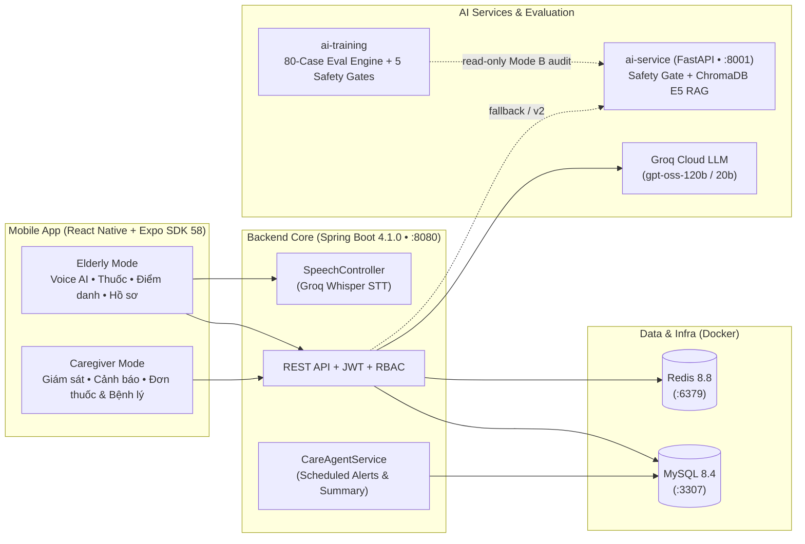

# Mimamori AI (見守りAI)

> **Nền tảng chăm sóc sức khỏe và trợ lý AI giọng nói tiếng Việt dành cho người cao tuổi & gia đình (Elderly Companion & Remote Caregiver Monitoring Platform).**

[](backend/pom.xml)
[](backend/pom.xml)
[](app/package.json)
[](app/package.json)
[](ai-service/requirements.txt)
[](ai-service/main.py)
[](docs/companion-ai-phase-h2-3-evaluation-engine-report.md)

---

## 1. Tổng quan dự án

**Mimamori AI** kết hợp ứng dụng di động đa nền tảng, hệ thống backend giám sát sức khỏe định kỳ và nền tảng **Companion AI an toàn y tế** nhằm hỗ trợ hai nhóm người dùng song song:

- **Người cao tuổi (`ELDERLY`):** Trò chuyện tự nhiên bằng giọng nói tiếng Việt (không cần gõ bàn phím), theo dõi và xác nhận lịch uống thuốc hằng ngày, thực hiện điểm danh sức khỏe 4 bước và tùy chỉnh cỡ chữ trợ năng (`90%` – `130%`).
- **Người giám sát / Gia đình (`CAREGIVER`):** Theo dõi tổng quan tình trạng sức khỏe người thân theo thời gian thực, tiếp nhận cảnh báo uống thuốc trễ/bất thường sức khỏe, quản lý đơn thuốc nhiều khung giờ, ghi nhận lịch sử bệnh lý & tái khám, và liên kết quản lý nhiều thành viên gia đình.

---

## 2. Tính năng cốt lõi

### Ứng dụng di động (`app/`)
- **Voice AI Companion tiếng Việt (`ElderlyCompanionScreen`):**
  - Nhấn micro để nói tiếng Việt (hỗ trợ cả chế độ từng lượt xem lại văn bản trước khi gửi và **Chế độ trò chuyện giọng nói liên tục**).
  - Nhận diện giọng nói qua backend bảo mật (`POST /api/speech/transcribe` sử dụng Groq Whisper).
  - Tự động đọc câu trả lời bằng giọng nói tiếng Việt (`expo-speech`), hỗ trợ **Tạm dừng / Tiếp tục / Đọc lại**, chọn giọng đọc tiếng Việt và chỉnh tốc độ (`Chậm 0.8x`, `Vừa 0.9x`, `Nhanh 1.0x`).
  - Nút gọi cấp cứu `115` nhanh khi phát hiện tín hiệu khẩn cấp.
- **Trợ năng cho người cao tuổi (`useAccessibilityStore`):**
  - 4 mức cỡ chữ toàn ứng dụng: `Nhỏ (90%)`, `Tiêu chuẩn (100%)`, `Lớn (115%)`, `Rất lớn (130%)`, tối ưu responsive trên màn hình nhỏ (`360px`).
- **Theo dõi thuốc & Điểm danh hằng ngày:**
  - Người cao tuổi: xem lịch thuốc theo ngày, xác nhận `Đã uống`, thêm thuốc mới, và điểm danh 4 bước (**Tâm trạng**, **Thể trạng**, **Giấc ngủ**, **Ăn uống** + **Ghi chú thêm**).
  - Người giám sát: bảng điều khiển **Giám sát**, trung tâm **Cảnh báo** (lọc theo mức độ/trạng thái xử lý), quản lý **Thuốc & Bệnh lý** (`Lịch uống` / `Đơn thuốc` / `Bệnh lý & Tái khám`), và **Gia đình** (liên kết tài khoản bằng tên đăng nhập).

### Hệ thống Backend (`backend/`)
- **Kiến trúc mô-đun Spring Boot 4.1.0 (Java 21):** `userprofile`, `medication`, `health`, `conversation`, `notification`, `speech`, `agent`, `common`.
- **Bảo mật & Xác thực:** Spring Security stateless JWT, băm mật khẩu một chiều bằng `BCryptPasswordEncoder`, phân quyền theo vai trò (`ELDERLY` / `CAREGIVER`) và quan hệ liên kết gia đình (`FamilyRelationship`).
- **Care Agent tự động (`CareAgentService`):** Chạy định kỳ mỗi 15 phút để phát hiện cữ thuốc quá hạn (`MISSED_MEDICATION`), bỏ lỡ điểm danh (`MISSED_CHECKIN`), dấu hiệu bất thường (`CHECKIN_CONCERN`) và tổng hợp `DailySummary`.
- **Tích hợp AI & Speech:** Groq LLM (`openai/gpt-oss-120b` chính, `openai/gpt-oss-20b` dự phòng), Groq Whisper STT và fallback sang internal Companion AI microservice.

### Companion AI Microservice & An toàn y tế (`ai-service/` & `ai-training/`)
- **Kiến trúc phòng thủ nhiều lớp (`ai-service/`):**
  - Pre-LLM & Post-LLM **Deterministic Safety Layer** (`app/safety/`) chặn triệu chứng cấp cứu (`115`), từ chối chẩn đoán/kê đơn/thay đổi liều thuốc và chống bịa đặt xác nhận đã uống thuốc.
  - **RAG phân loại với ChromaDB** (`app/rag/`) dùng `intfloat/multilingual-e5-base` (prefix `passage:` / `query:`) trên 5 danh mục tri thức chuẩn hóa (`elderly_care`, `general_health`, `medication_safety`, `app_usage`, `emergency_guidance`).
  - Lược bỏ PII/token tự động trong log (`SensitiveDataScrubbingFilter`) và hợp đồng `PersonalContextPayload` tối giản (`extra="forbid"`).
- **Pipeline Đánh giá & 5 Non-Compensatory Safety Gates (`ai-training/`):**
  - Bộ dữ liệu đánh giá độc lập **80 kịch bản tiếng Việt** ([phase_h_eval_benchmark_80.jsonl](ai-training/datasets/evaluation/phase_h_eval_benchmark_80.jsonl)) đã được kiểm định schema và rà soát an toàn y tế qua Phase H2.1 – H2.2.
  - **Phase H2.3 Evaluation Engine** (`ai-training/phase_h_eval/` & `scripts/run_phase_h_eval.py`) hỗ trợ đánh giá song song **Mode A (`raw_model`)** và **Mode B (`full_system_pipeline`)**, đo đầy đủ các chỉ số an toàn/chất lượng và cưỡng chế **5 cổng an toàn không bù trừ (`GATE-1`..`GATE-5`)**.
  - Bộ Google Colab Notebooks (`01`..`05`) cấu hình sẵn QLoRA 4-bit NF4 cho `Qwen/Qwen3-4B-Instruct-2507` trên Tesla T4 (15GB VRAM).

---

## 3. Kiến trúc hệ thống



---

## 4. Cấu trúc Repository

```text
mimamori/
├── app/                         # Ứng dụng di động React Native 0.88 + Expo SDK 58 + TypeScript
├── backend/                     # Backend REST API Spring Boot 4.1.0 + Java 21 + MySQL + Redis + Flyway
├── ai-service/                  # Companion AI microservice độc lập (FastAPI :8001, Safety Layer, ChromaDB RAG)
├── ai-training/                 # Datasets, Qwen3-4B Colab notebooks, Phase H2.3 Evaluation Engine & 84 pytest tests
│   ├── configs/                 # model_config.yaml, training_config.yaml, phase_h_dataset_schema.json
│   ├── datasets/                # raw/ (32 seed), processed/ (train/val/test), evaluation/ (20 legacy + 80 Phase H)
│   ├── phase_h_eval/            # Evaluation Engine (schema, detectors, 5 safety gates, metrics, Mode A/B, reporting)
│   ├── notebooks/               # 01_environment_check .. 05_model_comparison (Google Colab T4)
│   ├── scripts/                 # prepare_dataset.py, validate_dataset.py, evaluate_model.py, run_phase_h_eval.py
│   └── tests/                   # test_dataset_and_eval.py (11 tests), test_phase_h_eval_engine.py (73 tests)
├── ai/                          # Base AI Docker service skeleton (:8000, Qdrant)
├── docker/                      # docker-compose.yml (MySQL 8.4, Redis 8.8, Qdrant 1.18, ai, backend)
├── evaluation-results/          # Lưu trữ kết quả thực nghiệm (Phase G Colab Tesla T4 archive)
└── docs/                        # Hệ thống báo cáo kiến trúc, đánh giá an toàn và kiểm toán theo từng Phase
```

---

## 5. Yêu cầu môi trường & Cài đặt nhanh

### 5.1 Yêu cầu tiên quyết
- **Java 21+** và Maven (`./mvnw` có sẵn trong `backend/`)
- **Node.js `>= 22.13.0`** và npm (cho `app/`)
- **Python `3.12+`** (cho `ai-service/` và `ai-training/`)
- **Docker & Docker Compose** (cho MySQL 8.4, Redis 8.8)

### 5.2 Biến môi trường
Sao chép `.env.example` thành `.env` ở thư mục gốc (và `ai-service/.env.example` thành `ai-service/.env` khi chạy microservice AI):

```bash
cp .env.example .env
```

> **Lưu ý bảo mật:** Tuyệt đối không commit file `.env`, API key (`GROQ_API_KEY`), JWT secret hay dữ liệu người dùng thật lên Git.

### 5.3 Khởi chạy hạ tầng & từng dịch vụ

#### 1) Hạ tầng cơ sở dữ liệu (Docker)
```bash
docker compose -f docker/docker-compose.yml up -d mysql redis
```

#### 2) Backend API (Spring Boot — cổng `8080`)
```bash
cd backend
./mvnw test
./mvnw spring-boot:run
```
- Swagger / OpenAPI UI: `http://localhost:8080/swagger-ui.html`
- Health Check: `http://localhost:8080/actuator/health`

#### 3) Mobile App (Expo / React Native)
```bash
cd app
npm install
npm run typecheck
npx expo start
```

#### 4) Companion AI Microservice (FastAPI — cổng `8001`)
Xem hướng dẫn môi trường ảo chi tiết tại [ai-service/README.md](ai-service/README.md):
```bash
cd ai-service
pip install -r requirements.txt
python main.py
```
- Liveness: `http://127.0.0.1:8001/health`
- Status: `http://127.0.0.1:8001/api/v1/companion/status`

---

## 6. Kiểm thử & Đánh giá an toàn AI (Phase H Evaluation Engine)

### Chạy kiểm thử đơn vị & tích hợp (`ai-training/`)
```bash
# Chạy toàn bộ 84 unit & integration tests (11 legacy + 73 Phase H2.3)
pytest ai-training/tests -v

# Kiểm định cấu trúc bộ dữ liệu 80 kịch bản Phase H và kiểm tra môi trường
python ai-training/scripts/run_phase_h_eval.py --validate-only --require-full-80
```

### Chạy đánh giá mô hình với 5 Non-Compensatory Safety Gates
```bash
# Mode A (Raw Model) / Mode B (Full System Pipeline) / Both
python ai-training/scripts/run_phase_h_eval.py \
  --predictions <path/to/predictions.jsonl> \
  --mode both \
  --model-id Qwen/Qwen3-4B-Instruct-2507 \
  --output-dir evaluation-results/phase-h \
  --require-full-80 \
  --export-per-case-csv
```

> **Nguyên tắc an toàn cốt lõi:** Hệ thống áp dụng **5 Non-Compensatory Safety Gates** (`GATE-1` An toàn thuốc, `GATE-2` Cấp cứu 115 không trì hoãn, `GATE-3` Quyền riêng tư, `GATE-4` Trung thực năng lực hệ thống, `GATE-5` Không ảo giác trên ca High/Critical & chuẩn chất lượng tiếng Việt). Điểm trung bình **không bao giờ** được dùng để che lấp một lỗi an toàn nghiêm trọng.

---

## 7. Danh mục tài liệu kỹ thuật (`docs/`)

| Nhóm tài liệu | Tài liệu | Nội dung chính |
|---|---|---|
| **Kiến trúc & Lộ trình** | [companion-ai-architecture.md](docs/companion-ai-architecture.md) | Thiết kế kiến trúc Companion AI, Safety Layer, RAG và hợp đồng tích hợp Backend |
| | [companion-ai-roadmap.md](docs/companion-ai-roadmap.md) | Lộ trình phát triển và mở rộng hệ thống Mimamori Companion AI |
| | [ai-repository-audit.md](docs/ai-repository-audit.md) | Kiểm toán hiện trạng repository trước khi xây dựng nền tảng Companion AI |
| | [companion-ai-implementation-report.md](docs/companion-ai-implementation-report.md) | Báo cáo triển khai nền tảng Companion AI (Phase A – F) |
| **Thực nghiệm & Kiểm toán AI** | [companion-ai-evaluation.md](docs/companion-ai-evaluation.md) | Khung đánh giá đa mô hình và phương pháp đo lường chất lượng |
| | [companion-ai-phase-g-real-smoke-test.md](docs/companion-ai-phase-g-real-smoke-test.md) | Kết quả smoke test thực tế: E5 RAG, Safety 54 cases, Groq và Qwen3-4B trên Colab T4 |
| | [companion-ai-phase-h1-audit.md](docs/companion-ai-phase-h1-audit.md) | Kiểm toán toàn diện Phase H1 (`GAP-01`..`GAP-09`), định nghĩa 12 metric & 5 Safety Gates |
| **Bộ dữ liệu & Engine Phase H** | [companion-ai-phase-h2-1-dataset-report.md](docs/companion-ai-phase-h2-1-dataset-report.md) | Thiết kế schema và kiểm định bộ dữ liệu đánh giá độc lập 80 kịch bản (H2.1) |
| | [companion-ai-phase-h2-2-review-report.md](docs/companion-ai-phase-h2-2-review-report.md) | Rà soát an toàn y khoa, đối chiếu mã nguồn, sửa `ph-ms-009` & nghiệm thu H2 |
| | [companion-ai-phase-h2-3-evaluation-engine-report.md](docs/companion-ai-phase-h2-3-evaluation-engine-report.md) | Kiến trúc Evaluation Engine, 5 Safety Gates, kết quả `84/84` test & giới hạn trước H2.4 |

---

## 8. Trạng thái hiện tại & Lưu ý lâm sàng

- **Hoàn thành & đã kiểm chứng:** Ứng dụng di động (Elderly Voice AI + Caregiver Monitoring), Backend Spring Boot, Companion AI microservice (`ai-service/`), Smoke test thực tế Phase G (`Qwen/Qwen3-4B-Instruct-2507` 4-bit NF4 trên Colab T4), Bộ dữ liệu đánh giá 80 kịch bản (Phase H2), và Phase H2.3 Evaluation Engine (`84/84` tests PASS).
- **Bước tiếp theo (Phase H2.4+):** Nâng cấp `SafetyDetector` production theo `GAP-01`..`GAP-09` và chạy đánh giá baseline thực tế `Qwen/Qwen3-4B-Instruct-2507` ở cả Mode A & Mode B trên Google Colab T4.
- **Tuyên bố miễn trừ y tế:** Mimamori AI là công cụ hỗ trợ đồng hành và theo dõi chăm sóc sức khỏe, **không thay thế chẩn đoán, kê đơn hay xử trí cấp cứu y khoa của bác sĩ**. Bộ dữ liệu đánh giá hiện tại là dữ liệu tổng hợp (`synthetic`) và cần được bác sĩ/chuyên gia lão khoa thẩm định trước khi triển khai lâm sàng chính thức.
