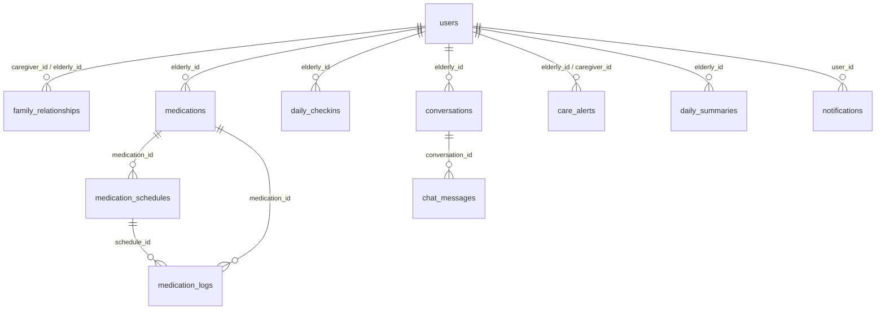
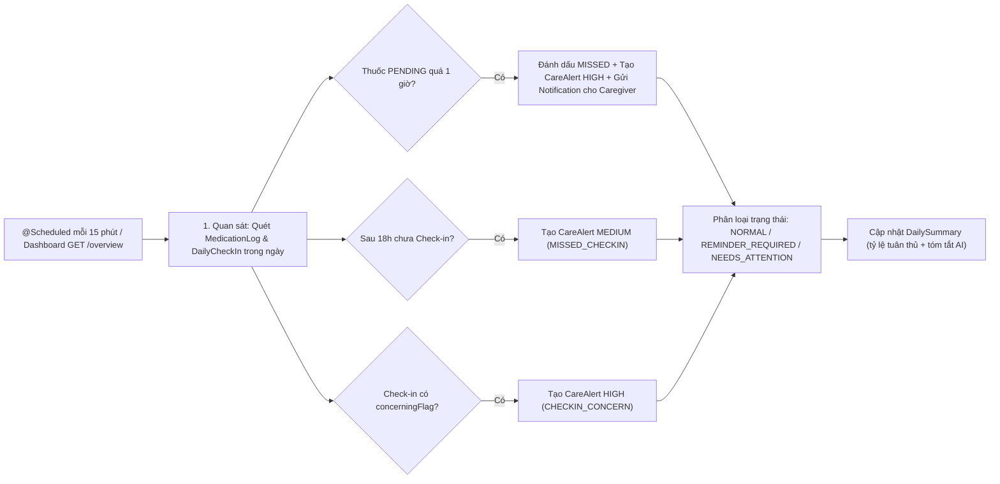

# Báo Cáo Chi Tiết Phần Backend — Mimamori AI (`e:\mimamori\backend`)

> Tài liệu phân tích toàn diện kiến trúc hệ thống, công nghệ, bảo mật, thiết kế cơ sở dữ liệu (11 bảng), các module nghiệp vụ theo Domain-Driven Package, cơ chế tích hợp Groq LLM AI, bộ lập lịch tự động (`CareAgentService`) và toàn bộ REST API Endpoints của phần Backend (`e:\mimamori\backend`).

---

## 1. Tổng quan công nghệ & Cấu hình (`pom.xml` & `application.yml`)

| Thành phần | Công nghệ / Phiên bản thực tế | Ghi chú cấu hình |
| :--- | :--- | :--- |
| **Framework** | Spring Boot `4.1.0` (`spring-boot-starter-parent`) | Khởi chạy tại `MimamoriBackendApplication` (`@EnableScheduling`), cổng mặc định `8080` |
| **Ngôn ngữ & JDK** | Java `21` | Biên dịch với tham số debug chuẩn Java 21 |
| **Cơ sở dữ liệu chính** | MySQL `8.4.10` (`mysql-connector-j`) | Kết nối JDBC qua `localhost:3307/mimamori`, chuẩn UTF-8 (`utf8mb4_unicode_ci`) |
| **Schema Migration** | Flyway (`spring-boot-starter-flyway` + `flyway-mysql`) | Quản lý qua `classpath:db/migration/V1__init_schema.sql` (`baseline-on-migrate: true`) |
| **ORM** | Spring Data JPA / Hibernate (`ddl-auto: validate`) | Kiểm tra khớp chặt chẽ giữa Entity Java và schema MySQL |
| **Cache & Lập lịch** | Redis (`spring-boot-starter-data-redis`, port `6379`) & Quartz (`job-store-type: memory`) | Hỗ trợ tác vụ định kỳ `@Scheduled` |
| **Bảo mật** | Spring Security + Custom JWT (`HMAC-SHA256`) + `BCryptPasswordEncoder` | Phiên không trạng thái (`SessionCreationPolicy.STATELESS`) |
| **Tích hợp AI** | Groq LLM API (`GroqService`) & Spring AI OpenAI starter (`2.0.0`) | Model chính `openai/gpt-oss-120b`, dự phòng `openai/gpt-oss-20b` (`https://api.groq.com/openai/v1`) |
| **Tài liệu API** | SpringDoc OpenAPI (`3.0.3`) | Tự động sinh Swagger UI (`/swagger-ui.html`) & `/v3/api-docs` |
| **Giám sát** | Spring Boot Actuator (`spring-boot-starter-actuator`) | Endpoint `/actuator/**` |

---

## 2. Kiến trúc phân tầng & Cấu trúc Package

Backend tổ chức theo **Modular Monolith (chia gói theo Domain nghiệp vụ)** gồm 5 phân hệ chính và 1 gói dùng chung:

```text
backend/src/
├── main/
│   ├── java/com/mimamori/
│   │   ├── MimamoriBackendApplication.java   # Entry point + @EnableScheduling
│   │   ├── common/                           # Bảo mật, JWT, Ngoại lệ, Wrapper API & Groq AI
│   │   │   ├── ApiException.java             # Ngoại lệ nghiệp vụ mang HTTP status code
│   │   │   ├── ApiResponse.java              # Khuôn phản hồi thống nhất {success, message, data, timestamp}
│   │   │   ├── GlobalExceptionHandler.java   # @RestControllerAdvice xử lý tập trung
│   │   │   ├── GroqService.java              # Client gọi Groq Chat Completions API
│   │   │   ├── JwtAuthFilter.java            # Bộ lọc xác thực Bearer Token mỗi request
│   │   │   ├── JwtService.java               # Sinh & kiểm tra chữ ký HMAC-SHA256
│   │   │   └── SecurityConfig.java           # Cấu hình CORS, Stateless, phân quyền URL
│   │   ├── userprofile/                      # Quản lý tài khoản, xác thực & liên kết gia đình
│   │   ├── medication/                       # Quản lý thuốc, khung giờ nhắc & nhật ký uống thuốc
│   │   ├── conversation/                     # Điểm danh hằng ngày (Check-in) & Hội thoại AI
│   │   ├── notification/                     # Cảnh báo chăm sóc (CareAlert) & Thông báo (Notification)
│   │   └── agent/                            # Care Agent định kỳ & Tổng hợp Dashboard
│   └── resources/
│       ├── application.yml                   # Cấu hình DB, Redis, Flyway, Groq AI, JWT, UTF-8
│       └── db/migration/
│           └── V1__init_schema.sql           # Kịch bản khởi tạo 11 bảng MySQL
└── test/java/com/mimamori/
    ├── JwtServiceTest.java                   # Unit test sinh/kiểm tra/từ chối token giả mạo
    └── MimamoriBackendApplicationTests.java  # Kiểm tra annotation @SpringBootApplication
```

---

## 3. Thiết kế Bảo mật, Xác thực & Xử lý Ngoại lệ (`com.mimamori.common`)

### 3.1. Luồng xác thực JWT (`SecurityConfig`, `JwtAuthFilter`, `JwtService`)
1. **Quy tắc phân quyền (`SecurityConfig.securityFilterChain`):**
   * Tắt CSRF (do dùng API REST không trạng thái), bật CORS cho phép mọi origin pattern (`*`) với đầy đủ phương thức (`GET`, `POST`, `PUT`, `DELETE`, `PATCH`, `OPTIONS`).
   * **Public Endpoints (`permitAll`):** `/api/auth/**`, `/actuator/**`, `/v3/api-docs/**`, `/swagger-ui/**`, `/swagger-ui.html`.
   * **Protected Endpoints:** Toàn bộ các đường dẫn `/api/**` còn lại bắt buộc phải xác thực JWT hợp lệ.
2. **Sinh & Xác thực Token (`JwtService`):**
   * Thuật toán **HMAC-SHA256** (`HS256`), payload chứa `sub` (username), `userId` (`Long`), `role` (`ELDERLY` / `CAREGIVER`), `iat` và `exp` (mặc định `86400000 ms` = 24 giờ).
   * Kiểm tra chữ ký bằng `MessageDigest.isEqual(...)` để chống tấn công so sánh thời gian (timing attack).
3. **Bộ lọc yêu cầu (`JwtAuthFilter`):**
   * Mở rộng `OncePerRequestFilter`, trích xuất header `Authorization: Bearer <token>`.
   * Nếu token hợp lệ, đẩy `userId` làm **Principal** và `ROLE_<role>` vào `SecurityContextHolder`, giúp mọi Controller nhận trực tiếp ID người dùng hiện tại qua `@AuthenticationPrincipal Long userId` mà không cần truy vấn lại token.

### 3.2. Chuẩn hóa Phản hồi & Xử lý Lỗi tập trung (`ApiResponse`, `GlobalExceptionHandler`)
* Mọi API đều trả về cấu trúc JSON đồng nhất qua `ApiResponse<T>`: `{ success, message, data, timestamp }`.
* `GlobalExceptionHandler` (`@RestControllerAdvice`) bắt 3 nhóm ngoại lệ:
  * `ApiException`: Trả về đúng HTTP status (400, 401, 403, 404...) cùng thông điệp nghiệp vụ.
  * `MethodArgumentNotValidException`: Gom toàn bộ lỗi `@Valid` theo từng field thành Map `{ field: message }` với HTTP `400 Bad Request`.
  * `Exception` tổng quát: Trả về HTTP `500 Internal Server Error`.

---

## 4. Kiến trúc Cơ sở dữ liệu MySQL (`V1__init_schema.sql`)

Cơ sở dữ liệu sử dụng Engine `InnoDB`, bảng mã `utf8mb4` (`utf8mb4_unicode_ci`) gồm **11 bảng quan hệ** liên kết chặt chẽ với `users`:



| STT | Bảng | Vai trò & Khóa/Ràng buộc đáng chú ý |
| :---: | :--- | :--- |
| 1 | `users` | Lưu tài khoản `ELDERLY` / `CAREGIVER`, `username` & `email` duy nhất (`UNIQUE`), `password_hash` (BCrypt), `phone`, `emergency_contact`, `avatar_url`, `language_preference` (`'vi'`). |
| 2 | `family_relationships` | Liên kết `caregiver_id` ↔ `elderly_id` (`UNIQUE uq_family_pair`), lưu `relationship_type`, `status` (`ACCEPTED`), cờ quyền xem hội thoại `can_view_conversations`. |
| 3 | `medications` | Danh mục thuốc của người cao tuổi (`name`, `dosage`, `instructions`, `start_date`, `end_date`, `is_active`). |
| 4 | `medication_schedules` | Khung giờ nhắc uống hằng ngày (`reminder_time`, `dosage_amount`, `days_of_week`). |
| 5 | `medication_logs` | Nhật ký từng cữ uống thực tế (`scheduled_time`, `taken_time`, `status`: `PENDING` / `TAKEN` / `MISSED` / `SKIPPED`). |
| 6 | `daily_checkins` | Điểm danh sức khỏe theo ngày (`UNIQUE uq_elderly_date` — mỗi cụ 1 bản ghi/ngày), lưu 4 chỉ số (`mood`, `physical_health`, `sleep_quality`, `appetite`), `concerning_flag` và `ai_analysis_summary`. |
| 7 | `conversations` | Phiên hội thoại AI của từng người cao tuổi (`title`, `last_message_at`). |
| 8 | `chat_messages` | Lịch sử từng tin nhắn (`sender`: `USER` / `AI` / `SYSTEM`, `content`, `tokens_used`). |
| 9 | `care_alerts` | Cảnh báo chăm sóc phát sinh khi trễ thuốc / chưa điểm danh / dấu hiệu bất thường (`alert_type`, `severity`, `is_read`, `is_resolved`, `resolved_at`). |
| 10 | `daily_summaries` | Báo cáo tổng hợp theo ngày (`UNIQUE uq_summary_elderly_date`), lưu `medication_adherence_rate`, `checkin_summary`, `alert_count`, `ai_health_note`. |
| 11 | `notifications` | Hộp thư thông báo nội bộ cho người dùng (`user_id`, `title`, `body`, `type`, `reference_id`, `is_read`). |

---

## 5. Chi tiết các Module Nghiệp vụ

### 5.1. Tài khoản, Hồ sơ & Gia đình (`com.mimamori.userprofile`)
* **`AuthService` & `AuthController` (`/api/auth`):**
  * Hỗ trợ đăng nhập không phân biệt hoa thường bằng `username` hoặc `email`.
  * Mã hóa mật khẩu bằng `BCryptPasswordEncoder`.
  * Cung cấp `/change-password` (xác thực mật khẩu cũ trước khi đổi) và `/forgot-password` (đặt lại mật khẩu mới tối thiểu 6 ký tự qua username/email).
* **`UserService` & `UserController` (`/api/users/me`):**
  * Đọc và cập nhật từng phần hồ sơ (`fullName`, `phone`, `emergencyContact`, `avatarUrl`, `languagePreference`).
* **`FamilyService` & `FamilyController` (`/api/family`):**
  * Chỉ tài khoản `CAREGIVER` mới được khởi tạo liên kết qua `elderlyUsername`; kiểm tra trùng cặp quan hệ và trả về danh sách theo góc nhìn người giám sát hoặc người cao tuổi.

### 5.2. Quản lý Thuốc & Nhật ký Uống thuốc (`com.mimamori.medication`)
* **`MedicationService` & `MedicationController` (`/api/medications`):**
  * Tạo thuốc kèm danh sách `reminderTimes`: nếu ngày hôm nay nằm trong khoảng `[startDate, endDate]`, hệ thống tự động sinh sẵn các bản ghi `MedicationLog` trạng thái `PENDING` cho từng khung giờ trong ngày.
  * Cho phép cả `ELDERLY` tự quản lý và `CAREGIVER` (đã liên kết) tạo, xem lịch hoặc xác nhận uống thuốc thay.
  * Khi gọi `GET /api/medications/today`, các cữ thuốc `PENDING` đã quá giờ dự kiến **trên 2 tiếng** tự động chuyển sang trạng thái `MISSED`.
  * Xóa thuốc sử dụng cơ chế **xóa mềm (soft-delete)** (`isActive = false`) để bảo toàn lịch sử.

### 5.3. Hội thoại AI & Điểm danh Sức khỏe (`com.mimamori.conversation` + `GroqService`)
* **`GroqService` (`com.mimamori.common`):**
  * Dùng `RestClient` gọi `https://api.groq.com/openai/v1/chat/completions` (`temperature: 0.7`).
  * **Cơ chế dự phòng 3 tầng cho trò chuyện (`ConversationService.fetchAiCompanionReply`):**
    1. Gọi **Groq LLM model chính** (`openai/gpt-oss-120b`, kèm tối đa 6 tin nhắn lịch sử gần nhất) với System Prompt quy định xưng *"cháu"* – gọi *"cụ/bác"*, trả lời đúng trọng tâm 2–4 câu tiếng Việt tự nhiên.
    2. Nếu lỗi/timeout, tự động fallback sang **model phụ** (`openai/gpt-oss-20b`), rồi tới dịch vụ AI nội bộ (`AI_SERVICE_URL/api/companion/chat`).
    3. Tầng cuối cùng là **Rule-based heuristic** phản hồi đúng ngữ cảnh (kể chuyện vui, thời tiết, đau mệt, uống thuốc).
  * **Hỗ trợ Payload linh hoạt (`ChatMessageRequest`):** Dùng `@JsonAlias({"message", "text"})` trên trường `content`, kết hợp kiểm tra rỗng tại `ConversationController` để tương thích mọi biến thể JSON từ client.
* **`CheckInService` & `CheckInController` (`/api/checkins`):**
  * Mỗi ngày chỉ lưu/cập nhật 1 bản ghi điểm danh (`uq_elderly_date`).
  * Tự động bật cờ `concerningFlag = true` nếu phát hiện các trạng thái rủi ro (`POOR`, `TIRED`, `PAIN`, `DIZZY`, `INSOMNIA`) và nhờ `GroqService.analyzeCheckIn(...)` sinh lời động viên 1–2 câu.

### 5.4. Care Agent tự động & Tổng quan Giám sát (`com.mimamori.agent` + `com.mimamori.notification`)



* **`CareAgentService`:** Chạy định kỳ mỗi **15 phút** (`@Scheduled(fixedRate = 900000)`) cho toàn bộ user `ELDERLY`, đồng thời được `DashboardService.getOverview` gọi trực tiếp để đảm bảo số liệu giám sát của người thân luôn khớp theo thời gian thực.
* **`AlertService` & `NotificationService`:** Mỗi khi tạo `CareAlert`, hệ thống tự động tra tìm `caregiver` đang liên kết và đẩy bản ghi vào bảng `notifications` cho người thân.

---

## 6. Bảng tổng hợp toàn bộ REST API Endpoints

| Nhóm API | Method & Path | Mô tả chức năng | Quyền truy cập |
| :--- | :--- | :--- | :--- |
| **Auth** | `POST /api/auth/register` | Đăng ký tài khoản `ELDERLY` hoặc `CAREGIVER` | Public |
| | `POST /api/auth/login` | Đăng nhập bằng username hoặc email, trả về JWT | Public |
| | `GET /api/auth/me` | Lấy thông tin người dùng hiện tại từ JWT | Đã đăng nhập |
| | `POST /api/auth/change-password` | Đổi mật khẩu (kiểm tra mật khẩu hiện tại) | Đã đăng nhập |
| | `POST /api/auth/forgot-password` | Khôi phục/đặt lại mật khẩu mới | Public |
| **User** | `GET /api/users/me`, `PUT /api/users/me` | Xem và cập nhật hồ sơ (`fullName`, `phone`, `emergencyContact`, `avatarUrl`) | Đã đăng nhập |
| **Family** | `POST /api/family/link` | Liên kết `CAREGIVER` với `ELDERLY` qua username | `CAREGIVER` |
| | `GET /api/family/members` | Lấy danh sách người thân đã kết nối | Đã đăng nhập |
| | `DELETE /api/family/link/{id}` | Gỡ bỏ liên kết gia đình | Thành viên trong quan hệ |
| **Medication** | `POST /api/medications` | Tạo thuốc mới & tự sinh lịch nhắc + log hôm nay | Đã đăng nhập |
| | `GET /api/medications` | Danh sách thuốc đang hoạt động (`isActive = true`) | Chính chủ / Người thân |
| | `GET /api/medications/today` | Lịch uống thuốc hôm nay (tự đánh dấu `MISSED` nếu trễ > 2h) | Chính chủ / Người thân |
| | `POST /api/medications/logs/{id}/confirm` | Xác nhận đã uống / bỏ qua cữ thuốc | Chính chủ / Người thân |
| | `GET /api/medications/history` | Lịch sử 50 lần uống thuốc gần nhất | Chính chủ / Người thân |
| | `DELETE /api/medications/{id}` | Ngừng lịch thuốc (soft delete `isActive = false`) | Chính chủ / Người thân |
| **Check-in** | `POST /api/checkins` | Gửi điểm danh hằng ngày & nhận phân tích Groq AI | `ELDERLY` |
| | `GET /api/checkins/today`, `GET /api/checkins/history` | Xem điểm danh hôm nay / lịch sử tối đa 30 ngày | Chính chủ / Người thân |
| **Conversation** | `GET /api/conversations/active` | Lấy hoặc tạo mới phiên hội thoại AI đang hoạt động | Đã đăng nhập |
| | `POST /api/conversations/{id}/messages` | Gửi tin nhắn (`content`/`message`/`text`) & nhận phản hồi AI | Chủ hội thoại |
| | `GET /api/conversations/{id}/messages` | Lấy lịch sử tin nhắn (kiểm tra cờ `canViewConversations`) | Chủ hội thoại / Người thân |
| **Dashboard** | `GET /api/dashboard/overview?elderlyId=...` | Tổng hợp trạng thái sức khỏe, tỷ lệ tuân thủ, thuốc, check-in, cảnh báo & tóm tắt | Chính chủ / Người thân |
| **Alerts** | `GET /api/alerts` | Danh sách cảnh báo chăm sóc theo vai trò | Đã đăng nhập |
| | `PUT /api/alerts/{id}/read`, `PUT /api/alerts/{id}/resolve` | Đánh dấu đã đọc / đã xử lý cảnh báo | Đã đăng nhập |
| **Notifications** | `GET /api/notifications`, `PUT /api/notifications/{id}/read` | Lấy danh sách thông báo & đánh dấu đã đọc | Đã đăng nhập |

---

## 7. Đánh giá kỹ thuật & Điểm cần lưu ý

1. **Tính nhất quán dữ liệu giữa Người cao tuổi và Người giám sát:** `DashboardService.getOverview` gọi trực tiếp `careAgentService.evaluateElderly(elderlyId)` tại thời điểm truy vấn, giúp giao diện Người chăm sóc luôn nhận trạng thái mới nhất khớp với hành động vừa diễn ra bên phía Người cao tuổi.
2. **Độ tin cậy dịch vụ AI:** Việc tách `GroqService` với cặp model `openai/gpt-oss-120b` → `openai/gpt-oss-20b` → Heuristic fallback giúp API trò chuyện không bao giờ bị treo hay trả lỗi chết khi mất mạng hoặc hết hạn mức model chính.
3. **Điểm cần hoàn thiện thêm (quan sát từ mã nguồn):**
   * Hiện tại trong `NotificationController.java` chỉ mới có `GET /api/notifications` và `PUT /api/notifications/{id}/read` (chưa định nghĩa `@PostMapping`), nên khi Frontend `SOSButton.tsx` gọi `POST /api/notifications` thì backend trả lỗi `405` và frontend bắt lỗi hiển thị thông báo đã liên lạc (nên bổ sung endpoint `POST /api/notifications` hoặc `POST /api/alerts/sos` nếu muốn lưu tín hiệu nút SOS vào DB).
   * Tác vụ `@Scheduled` của `CareAgentService` tạo `CareAlert` mỗi 15 phút khi trễ thuốc/chưa điểm danh chưa có cơ chế chống trùng lặp cảnh báo cho cùng một cữ thuốc/ngày (có thể kiểm tra tồn tại alert chưa xử lý trong ngày trước khi tạo mới).
   * Phần `JwtAuthFilter` đang truyền `userId` (`Long`) vào Principal nhưng `AlertController` / `NotificationController` hiện mới cập nhật trạng thái theo `alertId` mà chưa kiểm tra ownership trên `markAsRead`/`resolveAlert` tại `AlertService` — cần bổ sung kiểm tra quyền giống `NotificationService`.
