# Mimamori AI — Companion AI Architecture

> **Status**: Architecture Specification (Foundation Phase)  
> **Scope**: Standalone Companion AI training (`ai-training/`) and runtime service (`ai-service/`) integrated conceptually with the existing Mimamori AI platform (`backend/`, `app/`, `ai/`, `docker/`).  
> **Basis**: Grounded in the repository audit ([ai-repository-audit.md](file:///e:/mimamori/docs/ai-repository-audit.md)), Hugging Face model/hardware verification, and existing backend/mobile contracts. Existing `backend/`, `app/`, `ai/`, `docker/`, `.env`, and Flyway migrations (`V1__init_schema.sql`, `V2__health_conditions.sql`) remain unmodified.

---

## 1. Architectural Principles & Two-Project Isolation

The Companion AI system is split into two strictly decoupled top-level projects alongside the existing monorepo modules:

| Component | Path | Responsibility | Execution Environment | Existing Repo Coupling |
| :--- | :--- | :--- | :--- | :--- |
| **Offline Training & Eval** | `e:\mimamori\ai-training\` | Synthetic/curated Vietnamese dataset curation, quality validation, stratified splitting, QLoRA fine-tuning, and multi-model benchmarking | Google Colab Free T4 (15 GB VRAM) + Local Python `3.12` (prep/eval scripts) | **None** (no runtime dependency on `backend/`, `app/`, or `ai/`) |
| **Companion AI Service** | `e:\mimamori\ai-service\` | Standalone FastAPI microservice providing deterministic safety guardrails, Vietnamese ChromaDB RAG, personal context prompt assembly, and LLM provider routing | Localhost `127.0.0.1:8001` (CPU-compatible 16 GB Windows host; optional external LLM/GPU endpoint) | **None today**; future integration exclusively via Spring Boot HTTP interface contract (Section 6) |
| **Legacy Internal RAG Stub** | [e:\mimamori\ai\](file:///e:/mimamori/ai/pyproject.toml) | Existing Docker-managed Qdrant + FastAPI bootstrap (`mimamori-ai-1` bound to port `8000`) | Docker container (`Python >=3.13,<3.14` + `uv`) | Untouched; remains isolated on port `8000` |
| **Core Backend & Auth** | [e:\mimamori\backend\](file:///e:/mimamori/backend/pom.xml) | Spring Boot `4.1.0` (Java 21, port `8080`), HS256 JWT auth, MySQL (`:3307`), Redis (`:6379`), CareAgent (`@Scheduled`), Groq chat/Whisper proxy | Local JVM / Docker | Untouched in foundation phase |
| **Mobile App** | [e:\mimamori\app\](file:///e:/mimamori/app/package.json) | Expo SDK 58 / React Native `0.88.1` (`ELDERLY` & `CAREGIVER` UI, dual-engine STT, `expo-speech` TTS) | Android / iOS (`expo-dev-client`) | Untouched in foundation phase |

### Why Two-Project Isolation Is Required

1. **Dependency & Python Runtime Divergence**:
   - Existing `ai/` requires Python `>=3.13,<3.14` with `uv` (absent on the local Windows host) and is pinned in [ci.yml](file:///e:/mimamori/.github/workflows/ci.yml) and [docker-compose.yml](file:///e:/mimamori/docker/docker-compose.yml).
   - Training (`ai-training/`) relies on GPU-heavy libraries (`transformers`, `peft`, `trl`, `bitsandbytes`, `accelerate`, `datasets`) targeting Colab CUDA 12.x (`Python >= 3.11`).
   - Serving (`ai-service/`) must run cleanly on a 16 GB Windows CPU-only development laptop using Python `3.12` (`py -3.12`) without pulling CUDA/training libraries into production runtime containers.
2. **CI & Container Safety**:
   - [ci.yml](file:///e:/mimamori/.github/workflows/ci.yml) runs `backend`, `ai`, and `mobile` jobs on every push/PR. Keeping `ai-training/` and `ai-service/` separate prevents breaking existing CI jobs or the running `mimamori-ai-1` container (`0.0.0.0:8000`).
3. **Artifact & Git Hygiene**:
   - Multi-gigabyte model weights, LoRA checkpoints, and ChromaDB binary indices must never be committed to git; training checkpoints persist on Google Drive (`/content/drive/MyDrive/mimamori_companion_ai`), while local Chroma indices reside in an external or gitignored artifact path (e.g., `E:\mimamori_artifacts\chroma`).

---

## 2. System Topology & Request Flow

```mermaid
flowchart LR
    Mobile["Mobile App (app/) - ElderlyCompanionScreen & Voice STT/TTS"] -->|"HTTPS + JWT"| SpringBoot["Spring Boot Backend (backend/:8080) - Auth, MySQL, CareAgent"]
    SpringBoot -->|"Current: Direct Chat + Whisper"| GroqCloud["Groq Cloud API - gpt-oss-120b / 20b / whisper"]
    SpringBoot -.->|"Future Section 11 Contract (HTTPS/Local HTTP)"| CompanionAPI["ai-service FastAPI (127.0.0.1:8001)"]
    LegacyDocker["docker-compose ai (mimamori-ai-1:8000)"] --- Qdrant["Qdrant (:6333)"]

    subgraph AIService["ai-service/ (Standalone Runtime)"]
        SafetyPre["1. Deterministic Pre-Safety Gate (Emergency 115 + Medical Policy)"]
        RAG["2. ChromaDB + intfloat/multilingual-e5-base (5 Knowledge Categories)"]
        ContextFmt["3. Personal Context & Prompt Assembler (TTS-friendly Vietnamese)"]
        Provider["4. ModelProvider Abstraction (Local/OpenAI-Compat/Mock)"]
        SafetyPost["5. Post-LLM Medical Guardrail & Epistemic Validator"]
        SafetyPre -->|"Emergency Triggered (Bypass LLM)"| ResponseOut["Structured CompanionChatResponse"]
        SafetyPre -->|"Safe / Routine"| RAG --> ContextFmt --> Provider --> SafetyPost --> ResponseOut
    end

    CompanionAPI --> SafetyPre
    Training["ai-training/ (Colab Free T4 15GB)"] -.->|"QLoRA Adapter + Eval Metrics"| Provider
```

---

## 3. Model Strategy: Primary, Comparison, and Cloud Fallback

### 3.1 Hugging Face Model Comparison (`Qwen/Qwen3-4B-Instruct-2507` vs `Qwen/Qwen3.5-4B`)

Based on direct Hugging Face `config.json` and runtime compatibility checks:

| Dimension | `Qwen/Qwen3-4B-Instruct-2507` (Primary) | `Qwen/Qwen3.5-4B` (Benchmark Comparison) |
| :--- | :--- | :--- |
| **HF Task / Architecture** | `text-generation` / `Qwen3ForCausalLM` | `image-text-to-text` / `Qwen3_5ForConditionalGeneration` (`Qwen3_5ForCausalLM` ignores `model.visual.*` & `mtp.*` in `transformers >= 5.2.0`) |
| **`model_type`** | `qwen3` (36 pure dense Transformer layers) | `qwen3_5` / `qwen3_5_text` (VLM + hybrid 3:1 GatedDeltaNet `linear_attention` [24 layers] + `full_attention` [8 layers] + `vision` [24 blocks] + `mtp` [1 layer]) |
| **Total Params / BF16 Footprint** | `4,022,468,096` (~4.02B) / ~`8.05 GB` (3 shards) | `4,659,865,088` (~4.66B incl. vision + 248K vocab) / ~`9.32 GB` (2 shards) |
| **Vocab / Native Context** | `151,936` tokens / `262,144` native | `248,320` tokens / `262,144` native |
| **Thinking Mode** | **Non-thinking ONLY** (no `<think>` tags; direct reply) | **Thinking ON by default** (`chat_template.jinja` injects `<think>\n`; `/think` & `/nothink` switches unsupported, requires explicit `enable_thinking=False`) |
| **Minimum `transformers`** | `>= 4.51.0` | `>= 5.2.0` (plus `torchvision` & `pillow` for multimodal processor) |
| **LoRA `target_modules`** | Standard 7 modules (`q_proj`, `k_proj`, `v_proj`, `o_proj`, `gate_proj`, `up_proj`, `down_proj`) cover all 36 layers | Standard 7 modules hit only 8/32 `self_attn` + 32 MLP layers; requires adding `linear_attn` projections (`in_proj_qkv`, `in_proj_z`, `in_proj_a`, `in_proj_b`, `out_proj`) while excluding `conv1d` and `model.visual.*` |
| **Colab Free T4 (15 GB, `sm_75`) Fit** | **4-bit NF4 QLoRA fits safely (~6.5–9.5 GB VRAM)** using `fp16=True, bf16=False`, `paged_adamw_8bit`, `gradient_checkpointing=True` | **High friction**: Unsloth advises against 4-bit QLoRA (`load_in_4bit=False`) due to quantization divergence on `linear_attn` + `conv1d`; 16-bit LoRA falls back to `float32`/slow pure-PyTorch loops without `causal-conv1d`/`flash-linear-attention` (~10–12.5 GB text-only, ~11.5–14.5 GB VLM) |

### 3.2 Rationale for `Qwen/Qwen3-4B-Instruct-2507` as Primary Model

1. **Voice & Latency Fit**: Because `ElderlyCompanionScreen.tsx` speaks AI replies aloud via `expo-speech` (`vi-VN`, `0.9x` rate) and mobile requests face a 25-second timeout (`app/src/core/api/client.ts`), non-thinking direct generation avoids `<think>` reasoning token overhead and latency spikes.
2. **Colab Free T4 Reliability**: T4 (`sm_75`) lacks native `bf16` tensor cores and FlashAttention-2 (`sm_80+`). Dense `qwen3` 4-bit NF4 QLoRA runs stably within 15 GB VRAM using `float16` compute, whereas `qwen3_5` hybrid GatedDeltaNet layers introduce quantization instability and dependency fragility (`transformers >= 5.2.0`).
3. **Fair Gated Comparison**: `Qwen/Qwen3.5-4B` remains in the training/evaluation architecture strictly as a controlled comparison baseline guarded by explicit `transformers >= 5.2.0` version checks and `enable_thinking=False` handling—cleanly reporting `NOT_SUPPORTED` if an environment lacks `v5.2.0+`.

### 3.3 Runtime Provider Strategy & Groq Cloud Fallback

On the target local development machine (16 GB RAM, Windows CPU-only, no dedicated GPU), running an unquantized or full 4B Transformer live alongside MySQL, Redis, Qdrant, Spring Boot, and ChromaDB causes high memory pressure and multi-second/minute CPU latency. Therefore, `ai-service/` defines a `ModelProvider` abstraction:

1. **OpenAI-Compatible Cloud / Inference Server Provider (`OpenAICompatibleProvider`)**:
   - Primary low-latency runtime option on CPU-only hosts via Groq (`https://api.groq.com/openai/v1`, `openai/gpt-oss-120b` -> `openai/gpt-oss-20b` matching [GroqService.java](file:///e:/mimamori/backend/src/main/java/com/mimamori/common/GroqService.java)) or a self-hosted GPU vLLM/Ollama/OpenAI-compatible server hosting the fine-tuned `Qwen3-4B-Instruct-2507` LoRA adapter.
   - All API keys (`GROQ_API_KEY`, `OPENAI_COMPAT_API_KEY`) must be injected via environment variables with **no hardcoded defaults**.
2. **Local Transformers / Adapter Hook (`TransformersLocalAdapterProvider`)**:
   - Dedicated hook for GPU servers or quantized edge evaluation once a reviewed LoRA adapter passes safety/quality gates.
3. **Deterministic Mock Provider (`MockModelProvider`)**:
   - Zero-cost, zero-network development and test provider used in automated CI/unit tests.

Existing Spring Boot fallback ([GroqService.java](file:///e:/mimamori/backend/src/main/java/com/mimamori/common/GroqService.java)) continues to act as the resilient last-mile fallback (`gpt-oss-120b` -> `gpt-oss-20b` -> heuristic responses) if `ai-service/` is offline or times out during future backend integration.

---

## 4. Retrieval-Augmented Generation (RAG) Architecture

### 4.1 Vector Store & Embedding Selection

- **Vector Database**: Local **ChromaDB** (`PersistentClient`) stored outside git-tracked source code (configurable `CHROMA_PERSIST_DIR`, e.g. `E:\mimamori_artifacts\chroma`). Keeps `ai-service/` self-contained without mutating the `docker/docker-compose.yml` Qdrant instance reserved for `ai/`.
- **Primary Embedding Model**: **`intfloat/multilingual-e5-base`**
  - Architecture: `XLMRobertaModel` (`278.0M` params, `768` dims, `512` max tokens).
  - Footprint: `1.11 GB` FP32 `safetensors` (`279 MB` ONNX INT8); estimated **`~1.8–3.0 GB` Windows CPU RAM** including ChromaDB, and **`~20–50 ms/query`** on CPU.
  - Why chosen over alternatives: `BAAI/bge-m3` (`~568M` params, `2.27 GB` weights, `~3.5–6.0+ GB` RAM, `~200–400+ ms/query` on CPU) is too heavy for a 16 GB Windows laptop running Spring Boot + Docker, while `intfloat/multilingual-e5-small` (`117.7M`, `384` dims) has weaker Vietnamese semantic nuance and serves only as an ultra-light fallback.
- **Mandatory Prefix Discipline**: `intfloat/multilingual-e5-base` requires asymmetric prefixes enforced inside a dedicated embedding wrapper:
  - Ingestion / upsert: prepend `"passage: "` to every chunk.
  - Query / retrieval: prepend `"query: "` to every user query.
- **Offline Test Embedding Mode (`EMBEDDING_PROVIDER`)**:
  - `huggingface_e5`: Real semantic retrieval via `intfloat/multilingual-e5-base`.
  - `hash_dev` (default for unit tests / offline CI): Fast deterministic vector hashing so tests verify ChromaDB persistence, category filtering, and metadata without downloading 1.11 GB model weights.

### 4.2 Knowledge Base Isolation & Provenance Governance

Knowledge documents are separated into **five isolated domain categories** (stored and queried with strict category metadata filters):

1. `elderly_care` — Gentle daily companionship, sleep/hydration/mobility habits, emotional reassurance.
2. `general_health` — Non-diagnostic wellness education (weather adaptation, balanced elderly nutrition, warning-sign literacy).
3. `medication_safety` — General adherence hygiene (following doctor prescriptions, never doubling missed doses without medical advice, checking labels).
4. `app_usage` — Guidance for Mimamori features (Daily Check-in 4-step wizard, Medication confirmation, SOS button, Voice mode).
5. `emergency_guidance` — Verified Vietnam emergency response (`115`), family/caregiver escalation, safe waiting posture.

**Mandatory Provenance Metadata on Every Document**:
- `doc_id` (unique identifier)
- `source` (origin organization or authoring tag)
- `title`
- `updated_date` (ISO date)
- `version`
- `category` (one of the 5 enum values)
- `review_status` (`reviewed_official_hotline` | `sample_app_guide` | `sample_educational_pending_review`)

> [!IMPORTANT]
> Sample educational documents created during the foundation phase must explicitly carry a non-approved review status (`sample_educational_pending_review`) and must **never** be represented as clinically approved medical guidance. Only verified operational facts (such as Vietnam national emergency number `115` via `reviewed_official_hotline` on `emergency_guidance` docs, and product workflows via `sample_app_guide`) carry non-educational review tags.

### 4.3 Evidence Grounding & Uncertainty Communication

The RAG pipeline must strictly separate:
1. **Verified Retrieved Evidence** (`evidence_sources`): Returned with document `title`, `category`, `source`, `review_status`, and relevance score when retrieval meets similarity threshold.
2. **Personal Care Context**: Supplied solely by Spring Boot for the current user session (never stored inside shared ChromaDB vector collections).
3. **General / Unverified Knowledge Boundary**: When no relevant retrieved document meets the confidence threshold for a health, symptom, or medication question, the response must populate `uncertainty_note` / `knowledge_boundary` and instruct the elderly user to verify with a doctor, pharmacist, or family caregiver rather than fabricating specifics.

---

## 5. Deterministic Safety Layer (LLM-Independent)

Clinical and emergency safety must **not** depend solely on LLM prompt compliance or fine-tuning weights. `ai-service/` enforces a two-stage deterministic safety layer around every request:

### 5.1 Stage 1 — Pre-LLM High-Risk Emergency Gate

- **Normalization**: Converts incoming Vietnamese text to lowercase and evaluates both **diacritic-preserved** and **diacritic-stripped (ASCII-folded)** forms so STT errors, missing tone marks, or quick typing still match reliably.
- **Negation & Context Guards**: Distinguishes affirmative acute distress from negated or past-resolved statements (e.g., *"không bị đau ngực"* / *"hôm nay hết khó thở rồi"* vs *"tôi đang đau ngực và khó thở"*).
- **Red-Flag Symptom Coverage**:
  - Chest pain / tightness (`đau ngực`, `tức ngực`, `đau thắt ngực`)
  - Dyspnea / shortness of breath (`khó thở`, `ngộp thở`, `thở không nổi`)
  - Syncope / fainting (`ngất`, `xỉu`, `lịm đi`, `mất ý thức`)
  - Severe falls / trauma (`té ngã`, `bị ngã`, `ngã nặng`, `không đứng dậy được`)
  - Stroke warning signs (`đột quỵ`, `méo miệng`, `nói ngọng`, `yếu liệt tay chân`)
  - Severe bleeding or acute severe dizziness (`chảy máu nhiều`, `chóng mặt dữ dội`, `nôn ra máu`)
- **Action on Trigger**:
  - **Bypasses the LLM completely** (zero generation latency, zero hallucination risk).
  - Sets `safety_triggered = true`, `risk_level = "critical"` (or `"high"`), and populates `escalation_guidance`.
  - Returns an immediate, calm, TTS-clear Vietnamese instruction advising the elderly user to sit or lie down safely, contact family/caregivers immediately, and **call emergency services `115`**.
  - **Never** minimizes symptoms or gives false reassurance.

### 5.2 Stage 2 — Pre/Post-LLM Medical Policy Guardrail

- **Prohibited Actions**:
  1. Diagnosing diseases or interpreting clinical test results as a physician.
  2. Prescribing medication, recommending new drugs, or changing/stopping prescribed dosages.
  3. Claiming that an unrecorded or `PENDING`/`MISSED` medication dose was already taken when `personal_context.medication_logs` does not confirm `TAKEN`.
- **Enforcement**:
  - Pre-check flags explicit diagnosis/dosage-change prompts and injects hard boundary constraints (or returns a deterministic medical deferral when purely asking for prescription adjustments).
  - Post-check scans generated LLM text before returning to Spring Boot/mobile; if forbidden diagnostic or dosage-alteration phrasing appears, it overrides or appends mandatory safe medical-referral guidance (`safety_triggered = true`, `knowledge_boundary`).

### 5.3 Voice-First Output Formatting

To remain compatible with `app/src/core/voice/voiceSpeechService.ts` (`expo-speech`, `vi-VN`, default `0.9x` rate, chunked sentence speech):
- Default responses target **2–4 concise, warm Vietnamese sentences** using respectful pronouns (`cháu` — `cụ`/`bác`/`ông`/`bà`).
- Avoid markdown tables, dense bullet lists, or raw URLs in spoken conversational replies.

---

## 6. Personal Context Interface Contract (Section 11 — Spring Boot to FastAPI)

### 6.1 Architectural Boundary & Zero Schema Change Guarantee

Currently in `backend/`, [ConversationService.java](file:///e:/mimamori/backend/src/main/java/com/mimamori/conversation/service/ConversationService.java) (lines 124–158) calls `GroqService.generateCompanionReply(...)` with only `elderly.getFullName()` and up to 6 `ChatMessage` history entries, while the secondary call to `${AI_SERVICE_URL}/api/companion/chat` (`{"elderly_id", "message"}`) is unreachable whenever `GroqService` returns a heuristic fallback. Moreover, `Medication`, `MedicationSchedule`, `MedicationLog`, `DailyCheckIn`, `HealthCondition`, and `CareAlert` data are **not** passed into companion chat.

To add personalized companionship **without modifying any of the 12 existing Flyway tables** (`V1__init_schema.sql`, `V2__health_conditions.sql`) or giving `ai-service/` direct MySQL/Redis access:

1. **Spring Boot (`backend/`) remains sole owner** of:
   - JWT authentication (`JwtAuthFilter`, `JwtService`) and caregiver authorization (`FamilyRelationship.canViewConversations`).
   - Database persistence (`conversations`, `chat_messages`, `daily_checkins`, `medications`, `medication_logs`, `health_conditions`, `care_alerts`).
   - Proactive alerting (`CareAgentService`, `AlertService`, `NotificationService`).
2. **`ai-service/` remains stateless with respect to user PII and database credentials**:
   - Receives only a **minimal, request-scoped, sanitized `personal_context` snapshot** per turn.
   - Never persists `personal_context` into ChromaDB or plain-text application logs.

### 6.2 Request & Response Contract (`POST /api/v1/companion/chat`)

> **Endpoint**: `POST http://127.0.0.1:8001/api/v1/companion/chat`  
> **Legacy Shim Note**: During future Spring Boot wiring, `backend` (`mimamori.ai-service.url`) should point to `http://127.0.0.1:8001` and call `/api/v1/companion/chat` (replacing the stub payload `{"elderly_id", "message"}` currently targeting `/api/companion/chat` on `:8000`).

#### Request Payload (`CompanionChatRequest`)

| Field | Type | Source in Spring Boot (`backend/`) | Sanitization / Privacy Rule |
| :--- | :--- | :--- | :--- |
| `message` | `string` (required, `1..2000` chars) | `ChatMessageRequest.getContent()` | Non-empty user utterance |
| `conversation_id` | `string \| null` (optional, `<= 64` chars) | `String.valueOf(Conversation.id)` | Opaque thread reference only (validated against PII/secret patterns) |
| `personal_context` | `PersonalContextPayload` (optional, `extra="forbid"`) | Aggregated read-only from JPA repositories for `elderlyId` | Strictly scoped to authenticated user (`@AuthenticationPrincipal Long elderlyId`); rejects unexpected fields |
| `personal_context.preferred_honorific` | `string \| null` (optional, `<= 24` chars) | Derived honorific (`cụ`, `bác`, `ông`, `bà`) | **Do NOT send** `username`, `email`, `phone`, `passwordHash`, or `emergencyContact` |
| `personal_context.medication_schedules` | `list[MedicationScheduleContext]` (optional, `<= 10`) | `Medication` (`name`, `dosage`, `instructions`, `isActive=true`) + `MedicationSchedule` (`reminderTime`, `daysOfWeek`) | Omit `elderly` entity & internal DB foreign keys |
| `personal_context.medication_logs` | `list[MedicationLogContext]` (optional, `<= 15`) | Today's `MedicationLog` (`medicationName`, `scheduledTime`, `takenTime`, `status`: `PENDING\|TAKEN\|MISSED\|SKIPPED`) | Grounds whether a dose was actually recorded as `TAKEN` |
| `personal_context.daily_checkin` | `DailyCheckInContext` (optional) | Today's `DailyCheckIn` (`checkinDate`, `mood`, `physicalHealth`, `sleepQuality`, `appetite`, `concerningFlag`, `notes`) | Omit raw PII in `notes` (validated against PII/secret patterns) |
| `personal_context.health_notes` | `list[HealthNoteContext \| string]` (optional, `<= 10`) | Active `HealthCondition` (`conditionName`, `status`, `severity`, `summary`) | **Exclude** `doctorOrClinic` and PII identifiers; keep clinical summary concise |
| `personal_context.recent_messages` | `list[RecentMessageContext]` (optional, `<= 6`) | Last `<= 6` entries from `ChatMessage` (`USER` -> `user`, `AI` -> `assistant`, `SYSTEM` -> `system`) | Avoid duplicating the current `message` (fixing the double-append quirk currently in `GroqService`) |
| `category_hint` | `KnowledgeCategory \| null` (optional) | Optional domain filter (`elderly_care`, `general_health`, `medication_safety`, `app_usage`, `emergency_guidance`) | Defaults to searching across all 5 categories |
| `top_k` | `int` (default `3`, `1..8`) | Retriever result count | Controls RAG evidence chunk count |
| `include_general_knowledge` | `bool` (default `true`) | Evidence strictness toggle | When `false` and RAG lacks evidence, returns `insufficient_evidence` instead of LLM general chat |

#### Response Payload (`CompanionChatResponse`)

| Field | Type | Meaning & Downstream Consumer Behavior |
| :--- | :--- | :--- |
| `reply` | `string` | Concise Vietnamese reply ready to save in `chat_messages` (`MessageSender.AI`) and play via `expo-speech` |
| `safety_triggered` | `bool` | `true` if deterministic emergency gate or medical guardrail intervened |
| `risk_level` | `string` (`low\|moderate\|high\|critical`) | Allows Spring Boot to optionally mirror `high`/`critical` flags into `CareAlert` in a future phase |
| `escalation_guidance` | `string \| null` | Structured guidance (e.g., call `115` / contact caregiver) when `safety_triggered=true` or risk is `moderate` |
| `evidence_sources` | `list[EvidenceSource]` | Metadata & excerpts of ChromaDB chunks retrieved (`doc_id`, `title`, `category`, `source`, `updated_date`, `version`, `review_status`, `score`, `excerpt`) |
| `uncertainty_note` | `string \| null` | Explicit epistemic note when RAG lacks verified evidence for a clinical/medication query |
| `knowledge_boundary` | `string` | Explicit provenance boundary (`emergency_protocol`, `medical_guardrail_refusal`, `retrieved_evidence`, `general_guidance_only`, or `insufficient_evidence`) |
| `provider` | `string` | Active handler/provider identifier (`deterministic_safety_gate`, `rag_uncertainty_gate`, `mock_companion_provider`, `openai_compatible`, `transformers_local_adapter`) |
| `guardrail_flags` | `list[string]` | Machine-readable flags (e.g., `emergency_115_escalation`, `missing_evidence_uncertainty`, `pre_llm_dosage_guardrail`) |
| `used_personal_context` | `bool` | Whether sanitized `personal_context` was included in request processing |

#### Operational Budgets & Failure Semantics

- **Timeouts**: Spring Boot `RestClient` should enforce `<= 3–5s` connect timeout and `<= 15–18s` read timeout so that fallback to `GroqService` completes well within the mobile client's `25,000ms` timeout ([client.ts](file:///e:/mimamori/app/src/core/api/client.ts)).
- **Degraded Fallback**: If `ai-service` (`127.0.0.1:8001`) is unreachable or returns `5xx`, Spring Boot falls back seamlessly to `GroqService` (`openai/gpt-oss-120b` -> `openai/gpt-oss-20b` -> heuristic), preserving zero-downtime chat availability.

---

## 7. Security, Privacy, and Non-Public Localhost Deployment

1. **Non-Public Default Bind (`127.0.0.1:8001`)**:
   - `ai-service/` binds by default to `127.0.0.1` on port `8001`, preventing external LAN exposure and avoiding collision with the active `mimamori-ai-1` Docker container on `0.0.0.0:8000` (and Spring Boot on `:8080`).
   - Because `ai-service/` is an internal backend-to-backend service sitting behind Spring Boot's `JwtAuthFilter` (`SecurityConfig.java`), it should not be exposed directly to mobile clients over public interfaces without an internal service token or private network boundary.
2. **Secret Hygiene**:
   - Unlike the legacy fallback strings observed in [application.yml](file:///e:/mimamori/backend/src/main/resources/application.yml) and [GroqService.java](file:///e:/mimamori/backend/src/main/java/com/mimamori/common/GroqService.java), `ai-service/` and `ai-training/` **must never embed default API keys, HF tokens, or JWT secrets** in source code or `.env.example`. All credentials load strictly from environment variables or Colab Secrets (`userdata.get`).
3. **Log Redaction & PII Minimization**:
   - `ai-service/` logging must scrub `Authorization` headers, `Bearer` JWT tokens, API keys, and sensitive health/personal payloads (`personal_context`, raw messages) in structured logs—emitting only request IDs, latencies, `risk_level`, `safety_triggered`, and `provider` status.
4. **No Raw Patient Data in `ai-training/`**:
   - Consistent with [ai/datasets/README.md](file:///e:/mimamori/ai/datasets/README.md), `ai-training/` accepts only synthetic or strictly de-identified Vietnamese dialogues and enforces automated PII regex checks (Vietnamese phone numbers, CCCD/CMND IDs, emails) before any dataset split is accepted.
