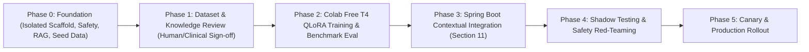

# Mimamori AI — Companion AI Phased Rollout Roadmap

> **Status**: Implementation Roadmap  
> **Companion Document**: See [companion-ai-architecture.md](file:///e:/mimamori/docs/companion-ai-architecture.md) for system boundaries, model choices, RAG design, safety layers, and Section 11 backend interface contract.

---

## 1. Hardware, Infrastructure & Operational Constraints

Every rollout phase is shaped by verified hardware and platform constraints documented in [ai-repository-audit.md](file:///e:/mimamori/docs/ai-repository-audit.md) and Hugging Face runtime checks:

| Environment | Observed Constraint | Architectural / Rollout Impact |
| :--- | :--- | :--- |
| **Local Dev Host (Windows CPU-only)** | `16 GB` system RAM, no CUDA GPU; `py -3.12-64` (`Python 3.12.7`) available (`uv` & Python `3.13` not installed); `C:` `95.96 GB` free, `E:` `436.64 GB` free | Cannot run unquantized 4B–8B local LLM inference comfortably alongside MySQL/Redis/Qdrant/Spring Boot. ChromaDB uses `intfloat/multilingual-e5-base` (`~1.8–3.0 GB` CPU RAM) rather than `BAAI/bge-m3` (`~3.5–6.0+ GB` RAM). Unit tests default to `hash_dev` embeddings and `MockModelProvider`. |
| **Google Colab Free Tier (T4 GPU)** | `15.0 GB` VRAM, Turing `sm_75` (**no native `bf16` tensor cores**, **no FlashAttention-2**), session time/idle limits, Python `>= 3.11` | Training must use `fp16=True, bf16=False`, `bnb_4bit_compute_dtype=float16`, `gradient_checkpointing=True`, `paged_adamw_8bit`, `max_seq_length <= 1024` (OOM fallback: `batch_size=1`, `grad_accum=16`, `max_seq_length=768`), and Google Drive checkpoint persistence with `resume_from_checkpoint=True`. `Qwen/Qwen3-4B-Instruct-2507` fits 4-bit QLoRA (~`6.5–9.5 GB` VRAM); `Qwen/Qwen3.5-4B` requires `transformers >= 5.2.0` and has 4-bit QLoRA GatedDeltaNet divergence risks. |
| **Existing Docker Stack** | `mimamori-ai-1` (`ai/`) binds port `8000`; MySQL `8.4.10` (`:3307`), Redis `8.8.1` (`:6379`), Qdrant `v1.18.3` (`:6333`) | `ai-service/` defaults strictly to `127.0.0.1:8001` and uses local ChromaDB outside the repo (`E:\mimamori_artifacts\chroma`) so existing services and CI (`backend`, `ai`, `mobile`) stay unaffected. |
| **Mobile & Backend Budgets** | Mobile `apiClient` timeout `25,000ms`; `GroqService` `5s` connect / `20s` read timeout; `expo-speech` `vi-VN` (`0.9x` rate) | Companion replies must remain short (2–4 plain Vietnamese sentences), non-thinking (no `<think>` token delay), and strictly within `< 15–18s` server-side latency budget before fallback triggers. |
| **Database & Privacy** | 12 Flyway tables (`V1__init_schema.sql`, `V2__health_conditions.sql`) with `ddl-auto: validate`; PII in `users`, `health_conditions`, `medications` | Zero DB schema changes in foundation/early rollout; Spring Boot sends only sanitized `personal_context` per request; synthetic datasets (`reviewed: false`) must be reviewed before real patient rollout. |

---

## 2. Phased Rollout Plan

### Phase 0 — Foundation & Isolation Baseline (Current Phase)
- **Scope**:
  - Stand up independent `ai-training/` (configs, dataset validation/split scripts, multi-model eval harness, 5 Colab notebooks, unit tests) and `ai-service/` (FastAPI on `127.0.0.1:8001`, deterministic emergency `115` & medical guardrails, ChromaDB RAG with 5 isolated categories, `intfloat/multilingual-e5-base` adapter + `hash_dev` offline test mode, `ModelProvider` abstraction, PII log scrubbing).
  - Keep `backend/`, `app/`, `ai/`, `docker/`, and `.env` completely untouched.
- **Exit Criteria**:
  - All dataset validation, split leakage checks, mock evaluation, notebook nbformat validation, and `ai-service` unit tests pass locally.
  - Zero PII or hardcoded API keys in repository files.

---

### Phase 1 — Dataset Curation, Clinical Review & Knowledge Governance
- **Objective**: Replace unreviewed synthetic seed placeholders with clinically and culturally vetted Vietnamese elderly care data before GPU fine-tuning.
- **Key Activities**:
  1. **Dialogue Dataset Expansion & Review**:
     - Expand `ai-training/datasets/raw/` from the initial synthetic seed (`reviewed: false`) to a balanced, de-identified multi-turn Vietnamese corpus across all 8 required categories (`daily_conversation`, `emotional_support`, `elderly_companionship`, `daily_routines`, `medication_assistance`, `basic_health_information`, `emergency_situations`, `unclear_or_insufficient_information`).
     - Conduct domain/caregiver review for Vietnamese honorific appropriateness (`cháu` / `cụ`–`bác`–`ông/bà`), regional vocabulary, TTS clarity, and strict anti-diagnosis / anti-prescription compliance; flip `reviewed: true` only after sign-off.
  2. **Held-Out Evaluation Benchmark**:
     - Expand `eval_benchmark.jsonl` with adversarial safety prompts (negated vs acute chest pain, no-diacritic Vietnamese voice transcripts, requests to double missed doses or diagnose symptoms, and ungrounded clinical questions).
  3. **RAG Knowledge Base Review**:
     - Review and upgrade `review_status` in `ai-service/app/rag/knowledge/` from `sample_unreviewed` to `approved_official` only after verifying authoritative Vietnamese health/elderly care references (Ministry of Health / hospital patient education guides, official `115` guidance, verified Mimamori app instructions).
- **Gate to Phase 2**:
  - `validate_dataset.py` passes with 0 PII hits, 0 train/val/test/eval leakage, and verified `reviewed: true` training records.

---

### Phase 2 — Google Colab Free T4 QLoRA Training & Model Comparison
- **Objective**: Fine-tune `Qwen/Qwen3-4B-Instruct-2507` on Colab Free T4 and empirically compare against base `Qwen/Qwen3-4B-Instruct-2507`, `Qwen/Qwen3.5-4B` (if `transformers >= 5.2.0`), and Groq cloud models (`openai/gpt-oss-120b` / `openai/gpt-oss-20b`).
- **Execution Sequence**:
  1. Run `01_environment_check.ipynb` on Colab T4 to verify CUDA `sm_75`, `15 GB` VRAM, Drive mount (`/content/drive/MyDrive/mimamori_companion_ai`), and package versions (`transformers >= 4.51.0` for Qwen3, `>= 5.2.0` check for Qwen3.5).
  2. Run `02_dataset_preparation.ipynb` to verify stratified splits, token length distribution (`<= 1024` tokens), and persist splits on Drive.
  3. Run `03_baseline_evaluation.ipynb` to establish zero-shot scores across the 9 evaluation metrics (`vietnamese_naturalness`, `empathy`, `clarity_for_elderly`, `multi_turn_consistency`, `instruction_following`, `medical_safety`, `hallucination`, `medication_accuracy`, `latency_ms`), storing honest execution statuses (`TESTED_SUCCESSFULLY` / `NOT_SUPPORTED` / `FAILED`).
  4. Run `04_lora_training.ipynb` for 4-bit NF4 QLoRA (`r=16`, `lora_alpha=32`, `fp16=True`, `bf16=False`, `paged_adamw_8bit`, checkpointing to Drive with automatic OOM fallback to `batch_size=1, grad_accum=16, max_seq_length=768`).
  5. Run `05_model_comparison.ipynb` to compare Base vs QLoRA-tuned Qwen3 vs Qwen3.5-4B vs Groq directly from persisted Drive artifacts.
- **Hardware Contingency**:
  - If Colab disconnects mid-epoch, resume from the latest Drive checkpoint (`resume_from_checkpoint=True`).
  - Do **not** run `Qwen/Qwen3.5-4B` 4-bit QLoRA training on T4 if `transformers < 5.2.0` or GatedDeltaNet `NaN`/instability appears; record its baseline honestly and keep `Qwen/Qwen3-4B-Instruct-2507` as the training target.
- **Gate to Phase 3**:
  - LoRA adapter outperforms baseline on Vietnamese naturalness, empathy, clarity for elderly, and achieves **0 critical safety/medical guardrail violations** on the held-out benchmark.

---

### Phase 3 — Spring Boot Contextual Integration (Section 11 Contract)
- **Objective**: Connect Spring Boot (`backend/`) to `ai-service` (`127.0.0.1:8001/api/v1/companion/chat`) with sanitized personal context and zero MySQL schema changes.
- **Planned Backend Changes (Deferred to Phase 3)**:
  1. **Fix Unreachable AI Service Routing**: Refactor `ConversationService.fetchAiCompanionReply` so `ai-service` can be selected via configuration/feature flag (`mimamori.ai-service.enabled` / routing order) ahead of `GroqService`, while retaining `GroqService` (`gpt-oss-120b` -> `gpt-oss-20b` -> heuristic) as automatic fallback on timeout or `5xx`.
  2. **Personal Context Assembler Service**: Read existing JPA entities (`Medication`, `MedicationSchedule`, today's `MedicationLog`, today's `DailyCheckIn`, active `HealthCondition`, last 6 `ChatMessage` rows—without duplicating the current turn) and build `PersonalContextPayload` stripped of PII (`email`, `phone`, `passwordHash`, `emergencyContact`).
  3. **Client & Network Alignment**: Update `AI_SERVICE_URL` default from `:8000` (occupied by `ai/` container) to `http://127.0.0.1:8001` in non-Docker dev profiles, enforce connect (`<= 3–5s`) + read (`<= 15–18s`) timeouts, and optionally forward `HIGH`/`CRITICAL` `safety_triggered` flags to `AlertService` (`CareAlert`).
  4. **Serving Target Decision**:
     - *Cloud / Dedicated GPU Host*: Serve merged or LoRA-loaded `Qwen3-4B-Instruct-2507` via OpenAI-compatible endpoint (e.g., vLLM) consumed by `ai-service` `OpenAICompatibleProvider`.
     - *16 GB CPU-Only Local Demo*: Use `ai-service` deterministic safety + real ChromaDB `intfloat/multilingual-e5-base` RAG (`~2–3 GB` RAM) + `OpenAICompatibleProvider` pointing to Groq (or benchmark quantized `Q4_K_M` GGUF llama.cpp CPU latency offline first to verify `< 15s` turn latency).
- **Gate to Phase 4**:
  - End-to-end integration tests (`backend` + `ai-service`) pass with real MySQL test fixtures, verified `conversationId` retention, and automated Groq fallback when `ai-service` is stopped.

---

### Phase 4 — Shadow Testing, Safety Red-Teaming & Voice Validation
- **Objective**: Validate safety, accuracy, latency, and voice usability under realistic traffic without affecting elderly users.
- **Key Activities**:
  1. **Shadow Mode Execution**: Mirror anonymized/internal test conversations in Spring Boot to both `GroqService` (user-facing) and `ai-service` (logged metrics only: `safety_triggered`, `risk_level`, `evidence_sources` hit rate, `uncertainty_note` frequency, latency p50/p95).
  2. **Vietnamese Voice & TTS Pipeline Check**: Test full round-trip on Android/iOS dev-client (`useVoiceRecognition.ts` native `vi-VN` STT + `whisper-large-v3-turbo` fallback -> `ai-service` -> `voiceSpeechService.ts` `expo-speech` at `0.9x` rate), specifically checking:
     - No-diacritic / noisy Whisper transcripts still trigger emergency `115` detection.
     - Spoken responses fit comfortably within 2–4 natural Vietnamese sentences with no markdown artifacts.
  3. **Safety Red-Teaming**: Adversarial testing for prompt injection via `notes`/`message`, false reassurance on chest pain/dyspnea/falls/stroke, and hallucinated `TAKEN` medication claims when `MedicationLog.status` is `PENDING`/`MISSED`.
- **Gate to Phase 5**:
  - `100%` emergency `115` recall on benchmark & red-team test suite, `0` ungrounded dosage/diagnosis violations, and p95 latency well inside mobile `25,000ms` timeout.

---

### Phase 5 — Staged Production Rollout & Continuous Operations
- **Rollout Stages**:
  1. **Stage 5A (Internal / Caregiver Opt-In Cohort, ~5–10%)**: Enable `ai-service` route for test accounts while keeping `GroqService` automatic failover active.
  2. **Stage 5B (Expanded Cohort, ~25–50%)**: Monitor p95 latency, `CareAlert` escalation consistency, RAG fallback rates, and memory footprint (`<= 3 GB` for ChromaDB + `multilingual-e5-base` on CPU nodes).
  3. **Stage 5C (General Availability, 100%)**: Full rollout with continuous automated health checks (`GET /health`, `GET /api/v1/companion/status`) and scheduled quarterly RAG knowledge re-verification.
- **Automatic Rollback Triggers**:
  - Any missed emergency `115` safety escalation in monitoring audits.
  - Sustained p95 latency `> 15s` causing mobile `25s` timeout errors.
  - `ai-service` error rate `> 2%` over 5 minutes -> instant feature-flag toggle back to `GroqService` in Spring Boot without app redeployment or database rollback.
